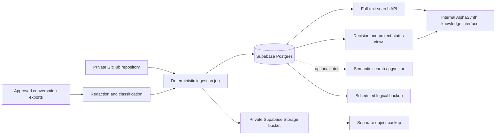

# AlphaSynth Knowledge Base — Supabase Design

Status: Proposed design for review; not yet implemented  
Date: 19 October 2026  
Scope: Internal project knowledge, documentation, decisions, diagnostics, and approved conversation exports

## 1. Purpose

Create a private, searchable knowledge base for AlphaSynth without replacing GitHub as the authoritative versioned repository.

The knowledge base should answer questions such as:

- What is the latest agreed FCS workflow?
- Which evidence-extraction problems affected a particular company?
- Which decisions are current, superseded, or still pending?
- Which documents discuss momentum, lifecycle, validation, or a named company?
- What remains unfinished before a release?

This system is for project memory and retrieval. It is not an FCS evidence source and must not turn an unverified conversation statement into financial evidence.

## 2. Source-of-truth policy

| Material | Authoritative location | Supabase role |
|---|---|---|
| Application code | Private GitHub repository | Catalogue and searchable references only |
| Markdown documentation | Private GitHub repository | Searchable indexed copy |
| Original conversation exports | Private archive | Restricted archival copy |
| Approved decisions | Git-tracked Markdown or database export | Structured, queryable decision register |
| Generated reports and attachments | Private object storage plus repository where appropriate | Metadata and extracted searchable text |
| Secrets and credentials | Secret manager only | Never stored |

GitHub remains the canonical source. Supabase is a derived knowledge index that can be rebuilt from approved source material.

## 3. Current scale

Initial workspace inventory, excluding `.git` and `node_modules`:

- Markdown files: approximately 1,205
- Markdown content: approximately 6.84 MB

This is small enough for an initial Supabase project. Database indexes, section rows, metadata, and future embeddings will consume more space than the raw Markdown, so usage must still be monitored.

## 4. Architecture

## 5. Storage design

### 5.1 Private object bucket

Bucket: `knowledge-archive`

Store:

- original Markdown snapshots;
- approved conversation exports;
- PDF and document attachments;
- ingestion manifests;
- generated database exports.

The bucket must be private. Access should use authenticated requests or short-lived signed URLs. Database backups do not restore deleted Storage objects, so the bucket needs a separate backup process.

### 5.2 PostgreSQL tables

#### `documents`

One row per source document.

Key fields:

- `id uuid primary key`
- `source_type text` — `github_markdown`, `conversation_export`, `report`, `attachment`
- `repository_path text`
- `storage_path text`
- `title text`
- `document_date date`
- `git_commit text`
- `content_sha256 text unique`
- `sensitivity text` — `internal`, `confidential`, `shareable`
- `status text` — `current`, `superseded`, `archived`
- `metadata jsonb`
- `created_at`, `updated_at`, `indexed_at`

#### `document_sections`

Searchable sections derived deterministically from documents.

Key fields:

- `id uuid primary key`
- `document_id uuid references documents`
- `section_order integer`
- `heading_path text[]`
- `content text`
- `content_tsv tsvector`
- `token_count integer`
- `metadata jsonb`

Create a GIN index on `content_tsv`. Do not add embeddings in phase one.

#### `conversations`

Conversation-level metadata only.

Key fields:

- `id uuid primary key`
- `external_thread_id text`
- `title text`
- `started_at`, `last_message_at`
- `source_export_path text`
- `sensitivity text`
- `metadata jsonb`

#### `conversation_messages`

Restricted message content from explicitly approved exports.

Key fields:

- `id uuid primary key`
- `conversation_id uuid references conversations`
- `message_order integer`
- `speaker text`
- `message_at timestamptz`
- `content text`
- `content_tsv tsvector`
- `redaction_status text`
- `metadata jsonb`

#### `decisions`

The curated layer that prevents obsolete discussion from appearing as current policy.

Key fields:

- `id uuid primary key`
- `decision_key text`
- `title text`
- `decision text`
- `rationale text`
- `status text` — `proposed`, `approved`, `superseded`, `rejected`
- `effective_at timestamptz`
- `supersedes_id uuid references decisions`
- `source_document_id uuid references documents`
- `source_message_id uuid references conversation_messages`
- `approved_by text`
- `metadata jsonb`

Only an explicitly approved decision may have `status = 'approved'`.

#### `companies` and `knowledge_company_mentions`

Provide consistent company and symbol references across documents.

`companies` should contain stable internal identifiers, NSE/BSE symbols, company name, and aliases. `knowledge_company_mentions` should link a company to a document section or conversation message and record whether the association was deterministic or inferred.

#### `ingestion_runs`

Audit every import.

Key fields:

- `id uuid primary key`
- `started_at`, `finished_at`
- `source_commit text`
- `files_seen`, `files_added`, `files_updated`, `files_skipped`, `files_failed`
- `status text`
- `error_summary jsonb`

## 6. Ingestion rules

1. Read only approved source folders.
2. Reject binary files from the Markdown parser.
3. Calculate SHA-256 before uploading.
4. Skip unchanged content.
5. Redact secrets before any conversation content leaves the local machine.
6. Preserve the original file separately from parsed sections.
7. Split Markdown by heading while retaining the full heading hierarchy.
8. Upsert using source path plus checksum; never create silent duplicates.
9. Mark removed or superseded files instead of immediately deleting them.
10. Record every ingestion run and failure.

The initial importer should be a deterministic TypeScript script in this repository. n8n may schedule it later, but the transformation rules should remain in version-controlled code rather than opaque workflow nodes.

## 7. Conversation policy

Raw conversation history is useful for audit, but it is noisy and can contradict later decisions.

Therefore:

- archive complete exports only after explicit approval;
- remove tokens, API keys, connection strings, personal contact details, and signed URLs;
- label assistant statements as discussion, not established fact;
- maintain a separate curated decision record;
- prefer approved decisions in search results;
- show the originating date and source for every result;
- allow a document or decision to be marked superseded.

Conversation capture should initially be a manual export/import process. Automatic synchronization should not be promised until a supported and permission-safe export mechanism exists.

## 8. Security baseline

- Use a separate Supabase project for the knowledge base.
- Enable Row Level Security on every exposed table.
- Grant no anonymous access.
- Keep the service-role key only in a server-side secret manager.
- Use a dedicated least-privilege ingestion role where practical.
- Require multi-factor authentication for administrative accounts.
- Keep all buckets private.
- Maintain an allow-list of ingested directories.
- Log imports and administrative changes.
- Never expose raw conversations through the public AlphaSynth frontend.

## 9. Search behavior

Phase-one search should use PostgreSQL full-text search with filters for:

- company;
- document type;
- topic;
- date;
- current versus superseded content;
- approved decisions only;
- sensitivity classification.

Search results must display title, matched excerpt, source path, source date, current/superseded status, and Git commit when available.

Semantic search is a later enhancement. It should be added only if documented search tests show that full-text search is insufficient.

## 10. Backup and recovery

- GitHub protects repository history but not database-only metadata.
- Run a scheduled logical database export using `pg_dump` or Supabase CLI.
- Export Storage objects separately; database backups include Storage metadata, not the objects themselves.
- Keep at least one backup outside Supabase.
- Test restoration before calling the system durable.

For a free Supabase project, perform manual or scheduled external backups because automatic database backups are not included and inactive projects may be paused.

## 11. Implementation phases

### Phase 1 — Private prototype

- Create Supabase project and private bucket.
- Apply schema and RLS migrations.
- Implement Markdown inventory, hashing, redaction checks, and ingestion.
- Import repository documentation only.
- Add full-text search and source links.
- Export a backup and prove restoration of a sample.

### Phase 2 — Curated project memory

- Add decisions and current-project-status records.
- Import a small, explicitly approved conversation sample.
- Test redaction and supersession behavior.
- Add company aliases and deterministic company references.

### Phase 3 — Automation

- Run ingestion after an approved GitHub update or on a controlled schedule.
- Add failure notification and ingestion dashboard.
- Consider n8n only as the scheduler/orchestrator.

### Phase 4 — Optional semantic retrieval

- Establish a retrieval test set.
- Add embeddings only if they materially improve retrieval.
- Keep access controls and citations identical to ordinary search.

## 12. Acceptance tests

The prototype is acceptable only if all of the following pass:

1. Re-running ingestion creates no duplicate documents or sections.
2. Modifying one Markdown file updates only that document.
3. A removed secret pattern prevents import and records a failure.
4. Anonymous requests cannot read tables or bucket objects.
5. Search for `Shilpa Medicare` returns the relevant diagnostic with its source path and date.
6. Search for `FCS workflow` ranks the current approved decision above superseded discussions.
7. A superseded decision is visibly labelled and links to its replacement.
8. A database export can be restored into a test project.
9. A Storage object can be restored from the independent object backup.
10. Deleting the Supabase index does not destroy the canonical GitHub material.

## 13. Build-review checklist

Before implementation approval:

- Confirm the Supabase region and account ownership.
- Confirm the GitHub repository is private.
- Approve the exact source folders for ingestion.
- Decide which conversation exports, if any, are allowed.
- Confirm the redaction patterns.
- Confirm retention and deletion rules.

Before production use:

- Review schema migrations.
- Review every RLS policy.
- Verify secrets are held outside the repository and database.
- Run the acceptance tests.
- Inspect a random sample of indexed documents.
- Confirm the backup and restore procedure.
- Record the operating cost and usage alerts.

## 14. Explicit non-goals

This build will not:

- replace GitHub;
- expose private conversations publicly;
- use conversation claims as verified FCS evidence;
- automatically resolve contradictory decisions;
- add embeddings before ordinary search is evaluated;
- become a second uncontrolled source of application truth.

## 15. Recommended decision

Proceed with a small private prototype after the current FCS work is safely checkpointed. Import repository Markdown first, evaluate retrieval quality, and add only approved conversation exports afterward. Start on the free plan, measure actual database and Storage usage, and upgrade only when continuous availability or managed backups become necessary.
